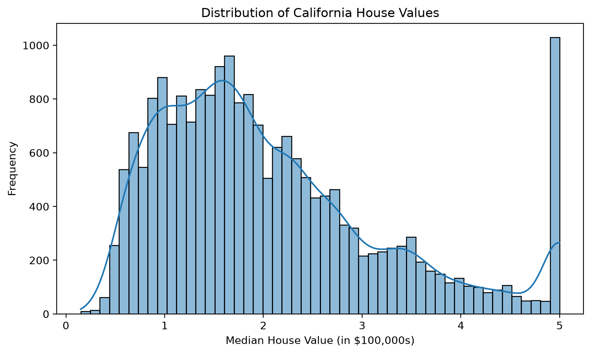
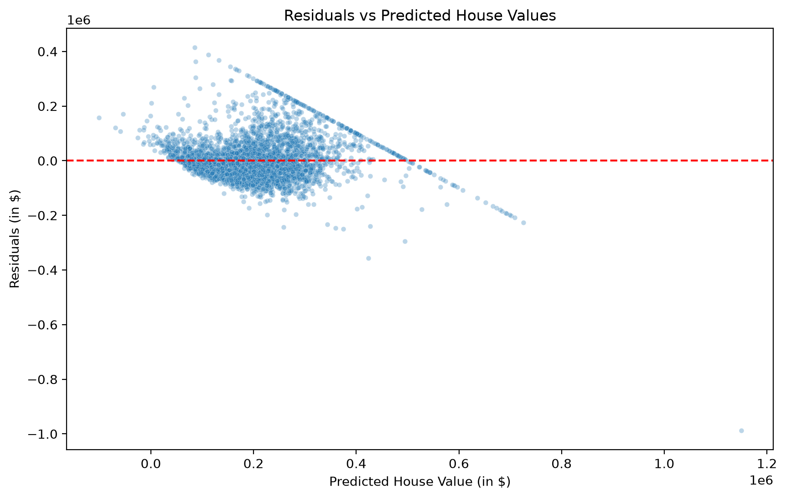
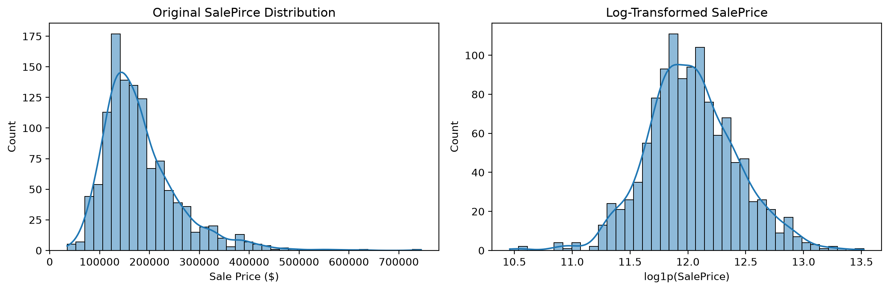
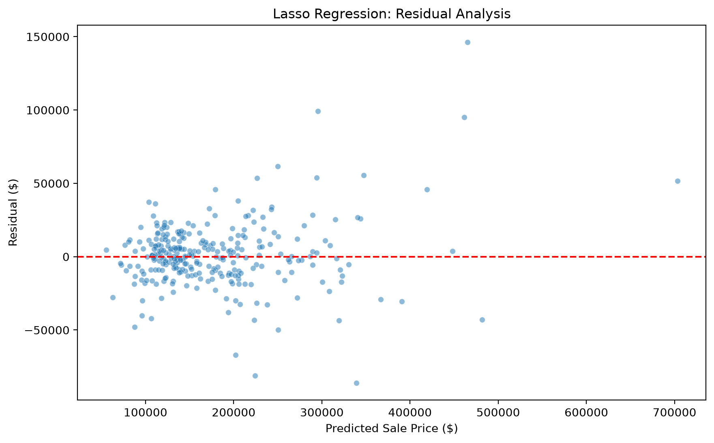

<h1 align="center">House Price Prediction with Linear Regression</h1>

<p align="center">
A hands-on machine learning project focused on understanding regression fundamentals through house price prediction using Python and scikit-learn.
</p>

<p align="center">
The project progresses from a relatively clean dataset to a more realistic dataset requiring additional preprocessing, feature engineering, and regularization.
</p>

<p align="center">
  
  
  
  
  
</p>

## Project Overview

The objective is to develop, evaluate, and improve regression models while understanding the complete machine learning workflow.

The project is divided into two phases:

- **Phase A: California Housing** — Build a baseline regression pipeline, perform exploratory data analysis, evaluate predictions, and experiment with feature engineering and regularization.
- **Phase B: Ames Housing** — Apply regression techniques to a more challenging dataset containing missing values, categorical features, and skewed distributions.

## Technologies Used

- **Python** — Primary programming language
- **pandas / NumPy** — Data manipulation and numerical operations
- **Matplotlib / Seaborn** — Data visualization
- **scikit-learn** — Regression models, preprocessing, and evaluation
- **Jupyter Notebook** — Interactive experiments and analysis
- **PyCharm** — Development environment

## Project Structure

```text
house-price-regression/
├── data/
├── notebooks/
│   ├── 01_california_housing.ipynb
│   └── 02_ames_housing.ipynb
├── reports/
│   └── figures/
├── src/
├── .gitignore
├── requirements.txt
└── README.md
```

- `data/` — Local datasets used in experiments.
- `notebooks/` — Exploratory analysis, model training, and evaluation.
- `reports/figures/` — Selected visualizations for documentation.
- `src/` — Reserved for future reusable Python modules.
- `requirements.txt` — Python dependencies needed to reproduce the project.

## Installation and Usage

### 1. Clone the Repository

```bash
git clone https://github.com/Furina-star/house-price-regression.git
cd house-price-regression
```

### 2. Create a Virtual Environment

```bash
python -m venv .venv
```

Activate it on Windows PowerShell:

```powershell
.\.venv\Scripts\Activate.ps1
```

### 3. Install Dependencies

```bash
python -m pip install -r requirements.txt
```

Use a Python version compatible with the pinned dependencies.

### 4. Run the Notebooks

1. Open the project in PyCharm or another Jupyter-compatible environment.
2. Select the project's virtual environment as the Python interpreter and notebook kernel.
3. Open `notebooks/01_california_housing.ipynb` or `notebooks/02_ames_housing.ipynb`.
4. Execute the notebook cells in order.

The California Housing dataset is retrieved using scikit-learn and may require an internet connection on the first run. For Ames Housing, place the Kaggle training dataset at `data/train.csv` before running the notebook.

Both notebooks support execution from the project root or `notebooks/`. The selected plots are saved to `reports/figures/` at 200 dpi with tight bounding boxes when their visualization cells run.

---

## Phase A: California Housing

### Objective

Establish a Linear Regression baseline using the California Housing dataset, evaluate predictive performance, and investigate improvements through feature engineering and regularization.

### Dataset

- **Source:** scikit-learn California Housing
- **Observations:** 20,640 census block groups
- **Original features:** 8 numerical features
- **Target:** Median house value (USD, stored in $100,000 units)
- **Data split:** 80% training, 20% testing (`random_state=42`)

### Methodology

1. Explored feature distributions, missing values, correlations, and geographic price patterns.
2. Standardized numerical features using `StandardScaler`.
3. Trained a baseline `LinearRegression` model.
4. Evaluated model performance using R², MAE, RMSE, and residual analysis.
5. Engineered `BedroomRatio` from average bedrooms and average rooms.
6. Compared Linear Regression, Ridge, and Lasso using 5-fold cross-validation.
7. Selected Ridge Regression based on cross-validation MAE and evaluated it on the held-out test set.

### Cross-Validation Results

| Model | Mean CV MAE |
|---|---:|
| Linear Regression | $52,906.07 |
| Linear Regression + Feature Engineering | $52,326.74 |
| Ridge + Feature Engineering | $52,306.44 |
| Lasso + Feature Engineering | $52,318.10 |

### Held-Out Test Results

| Metric | Baseline Linear Regression | Final Ridge Regression |
|---|---:|---:|
| R² | 0.5758 | 0.5942 |
| MAE | $53,320.01 | $52,556.97 |
| RMSE | $74,558.14 | $72,925.19 |

Ridge Regression with the engineered bedroom ratio achieved the lowest cross-validation MAE among the tested configurations. On the held-out test set, it reduced MAE by approximately 1.43% compared with the original baseline.

### Visualizations



Median house values are right-skewed, with a visible concentration at the dataset's upper price cap.



The baseline Linear Regression residuals show systematic patterns and substantial prediction errors; the red line marks zero error.

### Key Findings

- Median income showed the strongest positive linear correlation with median house value.
- Geographic features exhibited relationships not fully represented by their individual Pearson correlations.
- The target variable contains capped values, limiting prediction and evaluation accuracy for high-value areas.
- Feature engineering improved cross-validation performance more than regularization in this experiment.
- Residual analysis revealed systematic patterns and large prediction errors.
- Ridge and Lasso produced similar cross-validation performance, with Lasso retaining all nine features at its selected regularization strength.

### Limitations

The dataset represents census block groups rather than individual properties. Its capped target values and geographic structure limit the interpretation and generalizability of predictions.

The reported improvement is specific to the evaluated dataset and split. Additional evaluation would be required before practical deployment.

---

## Phase B: Ames Housing

### Objective

Extend the regression workflow to the Ames Housing dataset, focusing on missing-value handling, categorical encoding, target transformations, preprocessing pipelines, and regularization.

### Dataset

- **Source:** Kaggle House Prices: Advanced Regression Techniques
- **Observations:** 1,460 residential properties
- **Original features:** 79 predictors (36 numerical, 43 categorical)
- **Target:** SalePrice (USD)
- **Data split:** 80% training, 20% testing (`random_state=42`)

### Methodology

1. Investigated missing values and distinguished structural absence from unknown information.
2. Examined unusual properties and potential outliers.
3. Applied a logarithmic target transformation using `log1p`.
4. Explored One-Hot Encoding and Ordinal Encoding.
5. Built numerical and categorical preprocessing pipelines using `SimpleImputer`, `StandardScaler`, and `OneHotEncoder`.
6. Combined transformations using `ColumnTransformer`.
7. Trained and tuned Linear Regression, Ridge, Lasso, and ElasticNet using five-fold cross-validation.
8. Selected Lasso based on cross-validation MAE.
9. Evaluated the selected model on the held-out test set and examined residuals and prediction errors.

### Cross-Validation Results

| Model | Mean CV MAE |
|---|---:|
| Linear Regression | $18,529.62 |
| Ridge | $17,368.51 |
| Lasso | **$16,291.09** |
| ElasticNet | $16,392.26 |

### Final Test Results

**Selected model:** Lasso Regression

**Best tested alpha:** 0.0005

| Metric | Result |
|---|---:|
| R² | 0.9334 |
| MAE | $14,900.80 |
| RMSE | $22,597.20 |

The selected Lasso model achieved the lowest cross-validation MAE and set 189 of 305 processed feature coefficients to zero.

### Visualizations



The training-set distributions show how `log1p` reduces the right skew in sale prices.



The selected Lasso model's held-out residuals show greater error variability for higher-priced properties.

### Key Findings

- The logarithmic transformation reduced SalePrice skewness from 1.743 to 0.125.
- Missing-value treatment required distinguishing absent features from unknown measurements.
- Preprocessing pipelines enabled consistent feature transformations and leakage-safe cross-validation.
- Lasso outperformed the other tested regression models based on mean cross-validation MAE.
- Residual analysis showed larger error variability for higher-priced properties.
- Individual prediction errors remained substantial for some houses despite strong overall test performance.

### Limitations

The results are based on one train/test split and five-fold cross-validation. Hyperparameter selection and performance estimates may vary with different samples.
Rare categories, unusual sale conditions, and extreme property values may affect generalization. The largest residuals show that a high R² does not guarantee reliable predictions for every property.

---

## Project Conclusion

This project explored the fundamentals of supervised machine learning through two house price regression experiments, progressing from a relatively clean numerical dataset to a more complex dataset containing missing values and categorical features.

### Results

- **California Housing:** Ridge Regression achieved an R² of 0.5942 and a test MAE of $52,556.97.
- **Ames Housing:** Lasso Regression achieved an R² of 0.9334 and a test MAE of $14,900.80.

These results represent two independent experiments and are not directly comparable as measures of model superiority because the datasets have different targets, characteristics, and price distributions.

### Lessons Learned

The experiments demonstrated the importance of exploratory data analysis, feature engineering, appropriate missing-value treatment, categorical encoding, regularization, and cross-validation.

One important takeaway is that model performance depends not only on the chosen algorithm but also on how the data is prepared and evaluated.

Residual analysis further demonstrated that strong overall evaluation metrics do not guarantee accurate predictions for every observation.

### Limitations and Future Work

The models were developed for educational purposes and have not been validated for real-world property valuation.

Potential future improvements include additional feature engineering, more robust cross-validation strategies, and comparisons with nonlinear regression algorithms.

**Project Status: Completed**

Both planned regression experiments, their evaluations, and the associated documentation have been completed.